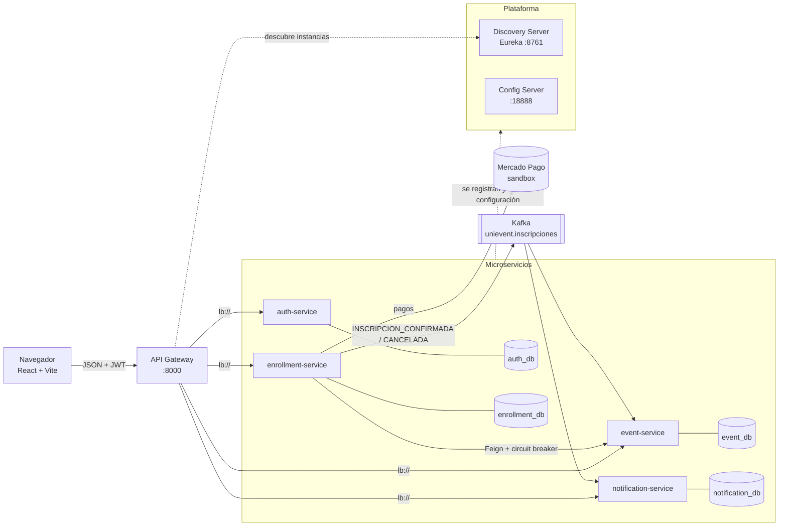

# Arquitectura distribuida

## Vista general



## Componentes

| Componente | Responsabilidad | Tecnología |
|---|---|---|
| Frontend | Interfaz por rol (estudiante, organizador, administrador) | React 19, Vite, Tailwind; servido por nginx |
| API Gateway | Único punto de entrada, enrutamiento con balanceo, CORS, reintentos y timeouts | Spring Cloud Gateway (WebFlux) |
| Config Server | Configuración centralizada por servicio y por ambiente (`dev`, `docker`) | Spring Cloud Config (repositorio *native*) |
| Discovery Server | Registro y descubrimiento de instancias | Netflix Eureka |
| auth-service | Usuarios, login, JWT, perfil y gestión de usuarios | Spring Boot, Spring Security, PostgreSQL |
| event-service | Eventos, categorías, dueño del evento, contador de inscritos | Spring Boot, PostgreSQL, consumidor Kafka |
| enrollment-service | Inscripciones, pagos con Mercado Pago, asistencia con QR | Spring Boot, OpenFeign, Resilience4j, productor Kafka |
| notification-service | Notificaciones a partir de eventos de negocio | Spring Boot, PostgreSQL, consumidor Kafka |
| Kafka | Mensajería asíncrona entre servicios | Apache Kafka 4 (KRaft) |
| Observabilidad | Métricas, paneles y trazas | Prometheus, Grafana, Zipkin |

## Comunicación entre servicios

**Síncrona (REST):**

- El frontend solo habla con el **API Gateway**. El gateway resuelve cada ruta con `lb://<servicio>`:
  consulta Eureka y reparte las peticiones entre las instancias (*round-robin*). Si una instancia no
  responde, reintenta las peticiones GET en otra (filtro `Retry`, timeouts de conexión y respuesta).
- **enrollment-service → event-service** con OpenFeign, también resuelto por Eureka y protegido con un
  **circuit breaker** (Resilience4j). Si event-service no está disponible, el circuito se abre y la
  inscripción responde 503 en lugar de esperar. Para saber qué eventos son de un organizador, Feign
  reenvía el JWT del usuario.

**Asíncrona (Kafka):**

- Al confirmarse una inscripción (evento gratuito, o pago aprobado en Mercado Pago) enrollment-service
  publica `INSCRIPCION_CONFIRMADA` en el tópico `unievent.inscripciones`.
- Si el pago se rechaza, la inscripción se anula (**compensación**) y se publica `INSCRIPCION_CANCELADA`.
- **event-service** (grupo `event-service`) suma el inscrito; **notification-service**
  (grupo `notification-service`) crea la notificación. Cada consumidor es **idempotente**.

Detalle de los mensajes y de la consistencia en [Datos y consistencia](datos.md).

## Seguridad distribuida

- auth-service emite un **JWT** (HS512) con el correo y el rol; todos los servicios lo validan con la
  misma clave (variable `JWT_SECRET`), sin consultar a auth-service en cada petición.
- **Autorización por rol** en las rutas (por ejemplo, solo `ORGANIZADOR`/`ADMIN` crean eventos).
- **Autorización a nivel de objeto**: un organizador solo modifica sus eventos y ve sus participantes;
  un estudiante solo ve y paga sus inscripciones y lee sus notificaciones. El usuario siempre se toma
  del JWT, nunca de parámetros de la petición.
- Secretos fuera del repositorio (`.env`, variables de entorno).

## Decisiones técnicas

| Decisión | Motivo |
|---|---|
| Una base de datos por servicio | Independencia de despliegue y de esquema; ningún servicio lee tablas de otro |
| Datos de otro servicio por correo/id (sin claves foráneas entre bases) | Las inscripciones guardan `eventoId` y `estudianteCorreo`; la información completa se obtiene por API |
| Kafka para los efectos secundarios de una inscripción | El estudiante no espera a que se actualice el contador ni se cree la notificación; si un consumidor está caído, procesa al volver |
| Consumidores idempotentes con `eventId` determinista | Kafka entrega *al menos una vez*: un mensaje repetido no debe sumar dos veces ni duplicar avisos |
| Circuit breaker solo en la llamada síncrona crítica | La inscripción depende de los datos del evento; ante una falla se responde rápido y claro (503) |
| JWT sin estado | Escala horizontalmente sin sesión compartida |
| Config Server con ambientes | Los mismos artefactos corren en local (`dev`) y en contenedores (`dev,docker`) cambiando solo hosts |
| Mercado Pago con referencia UUID por pago | Evita confundir pagos entre reinicios de la base (ver bitácora H-04) |

## Estructura del repositorio

```
unievent/
├── src/                      Frontend (React + Vite)
│   ├── api/                  Clientes HTTP por servicio (vía gateway)
│   ├── pages/                Pantallas por rol: student/, organizer/, admin/, auth/
│   └── components/           Layout y componentes de interfaz
├── services/
│   ├── api-gateway/          Spring Cloud Gateway
│   ├── discovery-server/     Eureka
│   ├── auth-service/
│   ├── event-service/
│   ├── enrollment-service/
│   └── notification-service/
├── infra/
│   ├── unievent-config/      Config Server y config-repo/ (configuración por servicio y ambiente)
│   ├── prometheus/           Configuración de Prometheus
│   └── grafana/              Fuentes de datos y paneles versionados
├── tests/e2e/                Pruebas integrales contra el sistema real
├── docker/frontend/          Imagen del frontend (nginx)
├── docs/                     Esta documentación (MkDocs)
├── docker-compose.yml        Sistema completo
└── .env.example              Variables a completar
```
