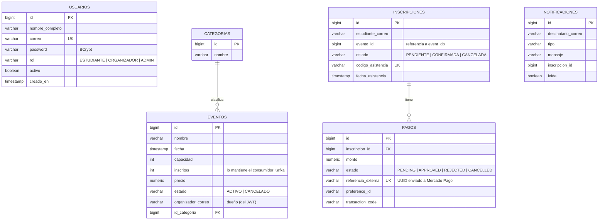
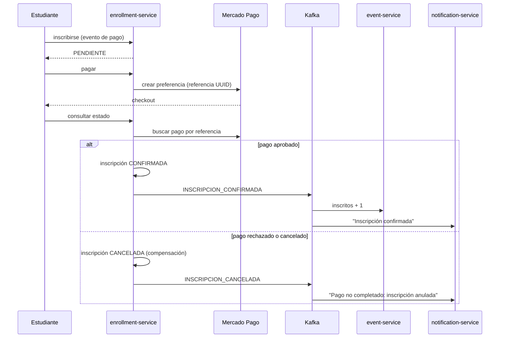

# Datos y consistencia

## Una base de datos por servicio

Cada microservicio tiene su propia base PostgreSQL y es el único que la lee y escribe. El esquema se
crea y versiona con **Flyway** (`src/main/resources/db/migration` de cada servicio). Entre servicios
no hay claves foráneas: se referencian por **id** o **correo** y la información se obtiene por API o
por eventos.



| Base | Servicio | Tablas |
|---|---|---|
| `auth_db` | auth-service | `usuarios` |
| `event_db` | event-service | `categorias`, `eventos`, `eventos_procesados` |
| `enrollment_db` | enrollment-service | `inscripciones`, `pagos` |
| `notification_db` | notification-service | `notificaciones`, `eventos_procesados` |

## Evento de negocio en Kafka

Tópico `unievent.inscripciones` (3 particiones; la clave del mensaje es el id de la inscripción, así los
mensajes de una misma inscripción llegan en orden).

```json
{
  "eventId": "b5f0…",                 // UUID determinista: mismo hecho de negocio = mismo id
  "tipo": "INSCRIPCION_CONFIRMADA",   // o INSCRIPCION_CANCELADA
  "ocurridoEn": "2026-11-12T22:53:42Z",
  "inscripcionId": 12,
  "pagoId": 7,                        // null en eventos gratuitos
  "eventoId": 11,
  "eventoNombre": "Charla de Bienvenida 2027",
  "estudianteCorreo": "estudiante@upeu.edu.pe",
  "monto": 0
}
```

| Consumidor | Grupo | Efecto |
|---|---|---|
| event-service | `event-service` | `INSCRIPCION_CONFIRMADA` → `inscritos + 1` (ignora los demás tipos) |
| notification-service | `notification-service` | Crea "Inscripción confirmada" o "Pago no completado: inscripción anulada" |

## Consistencia

### Idempotencia

Kafka garantiza entrega *al menos una vez*, por lo que un mensaje puede llegar repetido.

- El `eventId` es determinista: `UUID(tipo + ":" + inscripcionId)`.
- Cada consumidor guarda los `eventId` procesados en `eventos_procesados` (clave primaria) **en la misma
  transacción** que su efecto. Si el id ya existe, el mensaje se ignora; si dos consumidores lo procesan
  a la vez, la clave primaria impide el doble registro.
- El contador se incrementa con una sola sentencia atómica (`UPDATE … SET inscritos = inscritos + 1`).

Otras operaciones idempotentes:

| Operación | Mecanismo |
|---|---|
| Inscribirse dos veces al mismo evento | Índice único parcial (estudiante, evento) sin contar las canceladas; si hay una pendiente se reutiliza |
| Pedir el pago dos veces | Se reutiliza el checkout pendiente; índice único de pago activo por inscripción |
| Escanear el mismo QR dos veces | `UPDATE … WHERE fecha_asistencia IS NULL`: solo el primer escaneo registra |

### Compensación (patrón saga simplificado)



La inscripción pendiente reserva el lugar del estudiante; si el pago falla, la compensación la anula, el
estudiante es notificado y puede volver a inscribirse. Los cupos se cuentan solo con inscripciones
confirmadas.

### Riesgo aceptado

El mensaje a Kafka se envía después de guardar en la base pero sin el patrón *transactional outbox*: si
la transacción fallara justo después del envío, el aviso quedaría publicado. Se acepta porque los
consumidores son idempotentes y el caso es muy improbable; el outbox queda como mejora
([Limitaciones](limitaciones.md)).
