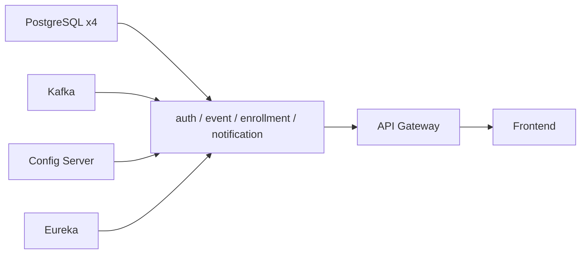

# Infraestructura

El sistema completo se define en [`docker-compose.yml`](https://github.com/jacson2045/unievent/blob/main/docker-compose.yml).

## Contenedores

| Contenedor | Imagen | Puerto publicado | Healthcheck |
|---|---|---:|---|
| postgres-auth / -event / -enrollment / -notification | `postgres:16` | — (red interna) | `pg_isready` |
| kafka | `apache/kafka:4.0.2` (modo KRaft) | — | `kafka-broker-api-versions` |
| config-server | construida desde `infra/unievent-config` | — | `/actuator/health` |
| discovery-server | construida desde `services/discovery-server` | 8761 | `/actuator/health` |
| auth / event / enrollment / notification-service | construidas desde `services/*` | — | `/actuator/health` |
| api-gateway | construida desde `services/api-gateway` | 8000 | `/actuator/health` |
| frontend | `docker/frontend` (nginx) | 8443 | `wget /` |
| prometheus | `prom/prometheus:v3.15.0` | 9090 | — |
| grafana | `grafana/grafana:13.2.4` | 3000 | — |
| zipkin | `openzipkin/zipkin:3.5` | 9411 | integrado |
| kafka-ui | `provectuslabs/kafka-ui:v0.7.2` | 8085 | — |

Solo se publican los puertos de las interfaces de usuario y del gateway: las bases de datos, Kafka y los
microservicios solo son accesibles dentro de la red `unievent`.

## Orden de arranque

`depends_on` con `condition: service_healthy`: un contenedor arranca cuando sus dependencias están
**listas**, no solo iniciadas.



En una máquina con 16 CPU y 8 GB para Docker, el sistema queda `healthy` en unos 40-60 segundos.

## Imágenes

Las imágenes de los servicios son **multi-etapa**: compilan con Maven (o pnpm) dentro de Docker y ejecutan
con un JRE como usuario sin privilegios. No se necesita JDK ni Node.js en la máquina. Cada JVM tiene un
límite de memoria (`-Xmx320m`, `-Xmx192m` en la plataforma); el sistema completo usa unos 4,5 GB.

## Configuración por ambiente

El Config Server sirve la configuración desde `infra/unievent-config/config-repo` (montado en el
contenedor, editable sin reconstruir):

| Archivo | Se aplica a |
|---|---|
| `application.yml` | Todos los servicios: Eureka, trazas, métricas, patrón de logs |
| `application-docker.yml` | Todos, en el ambiente `docker`: hosts de la red de contenedores |
| `<servicio>-dev.yml` | Un servicio en desarrollo local |
| `<servicio>-docker.yml` | Un servicio en Docker: su base de datos |

Los servicios activan `SPRING_PROFILES_ACTIVE=dev,docker` en Docker y `dev` en local. Los secretos llegan
por variables de entorno (`.env`), nunca desde el repositorio.

## Escalado

```bash
docker compose up -d --scale event-service=2
```

Las réplicas se registran en Eureka con un id distinto (`servicio:contenedor:puerto`), el gateway reparte
entre ellas y Prometheus las mide automáticamente. Los consumidores Kafka de un mismo grupo se reparten
las particiones del tópico, sin procesar dos veces un mensaje.
